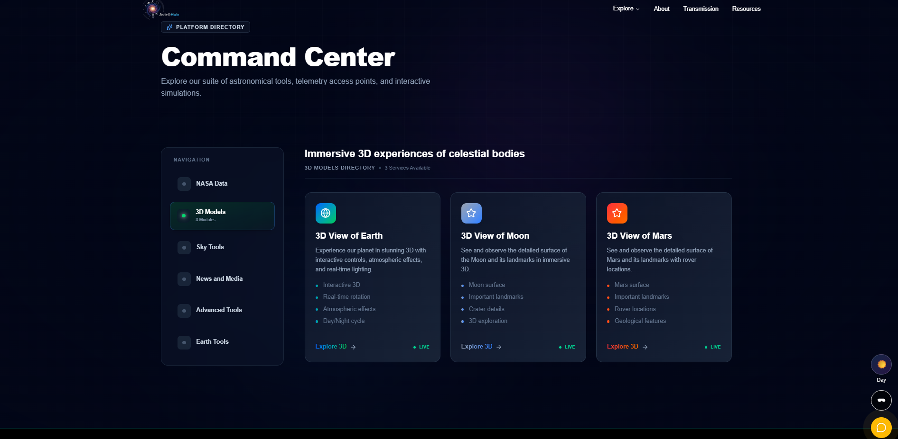
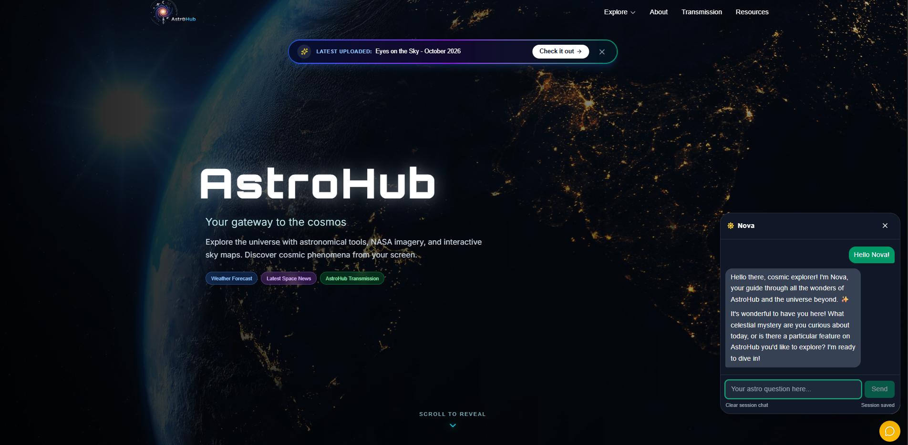
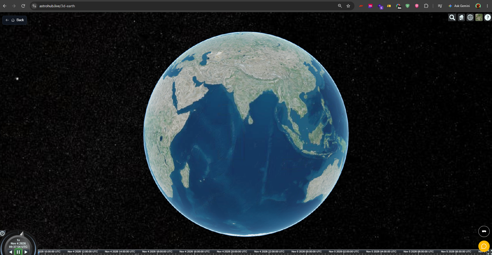
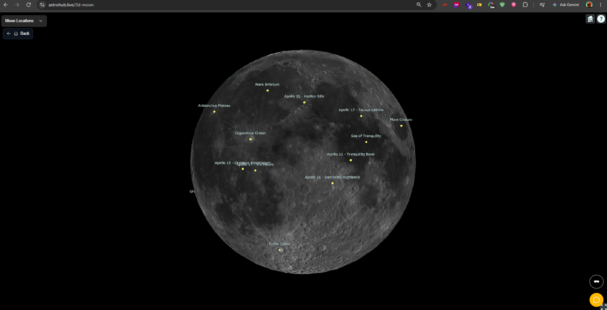
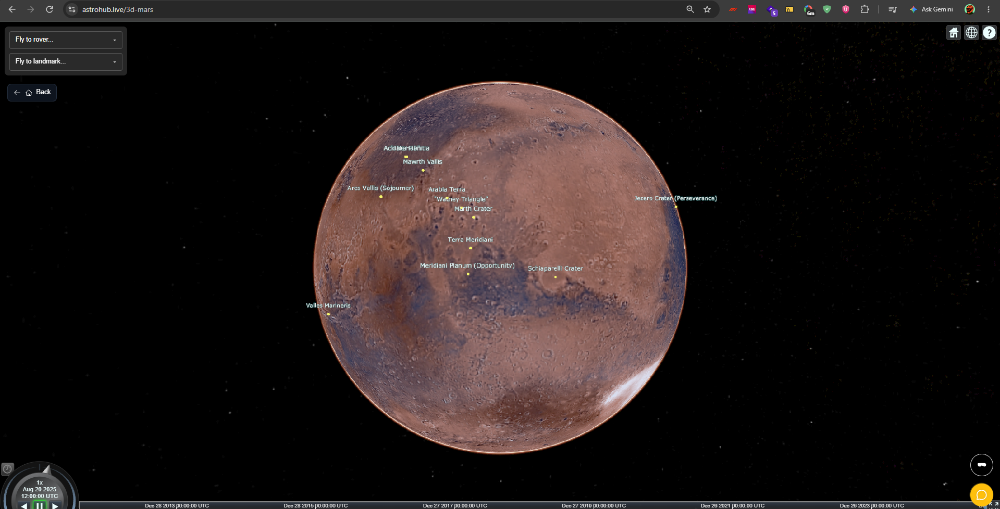
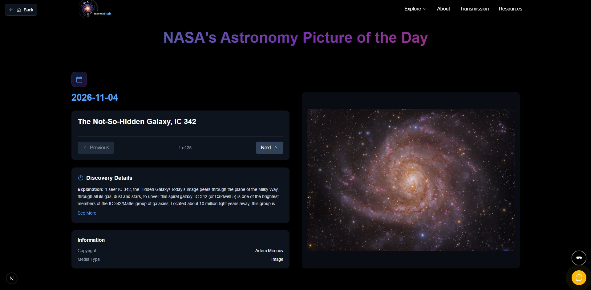
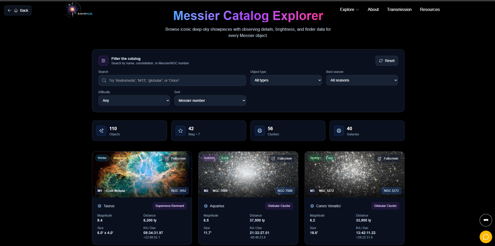
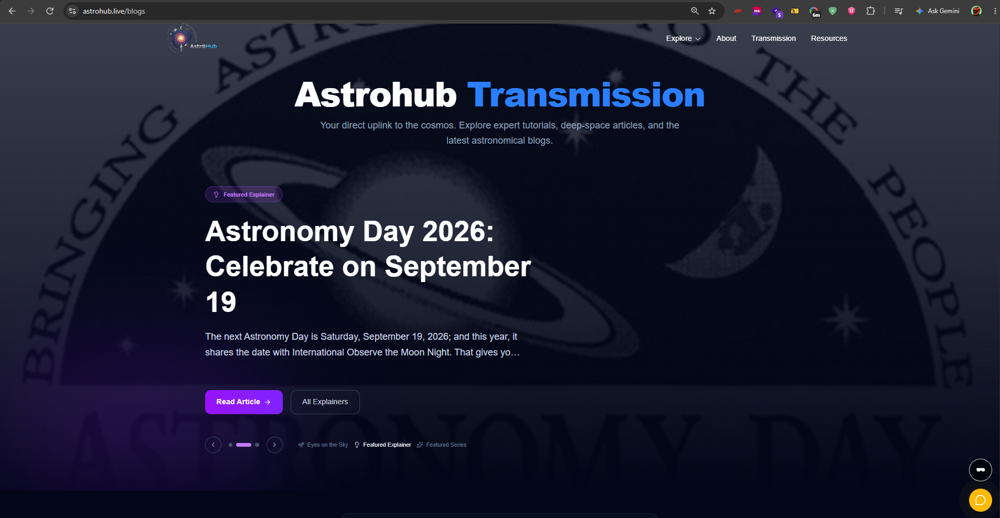
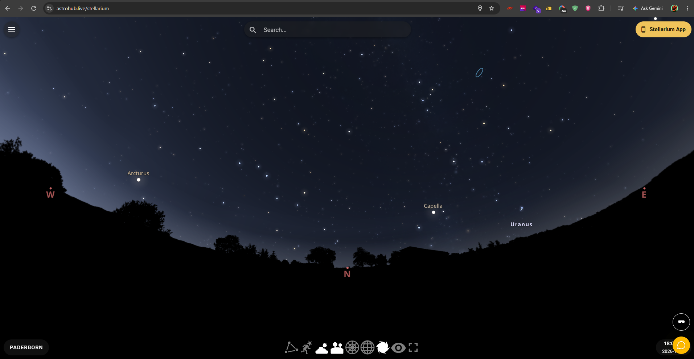

# AstroHub


[AstroHub](https://astrohub.live) is a production astronomy website for exploring space, observing the night sky, and learning about the universe. This repository contains the web application behind the live site.

## Explore the site

- [NASA imagery and data](https://astrohub.live/apod): Astronomy Picture of the Day, EPIC Earth imagery, Mars rover photos, near-Earth objects, and NASA's image and video library.
- [Interactive space](https://astrohub.live/solar-system): 3D Earth, Moon, and Mars experiences, solar system exploration, NASA Eyes, and satellite tracking.
- [Sky and observing tools](https://astrohub.live/stellarium): Stellarium sky map, monthly sky charts, local astronomy, weather, and light-pollution maps.
- [Calculators](https://astrohub.live/telescope-calculator): Telescope and eyepiece planning, astrophotography exposure planning, and a cosmic-age calculator.
- [AstroHub Transmission](https://astrohub.live/blogs): The astronomy blog, with monthly sky guides, tutorials, explainers, and author pages. The site also features space news and interactive quizzes.
- [Nova AI](https://astrohub.live): Ask astronomy questions and get a daily celestial briefing, powered by Gemini 2.5 Flash.

## Images and visualizations


















AstroHub presents astronomy imagery from NASA's APOD, EPIC, Mars rover, and image-library services. Interactive 3D views include Earth, the Moon, Mars, and the solar system. The repository includes the AstroHub logo and application assets; the astronomy photos and live data are served by their respective providers.

## Requirements

- Node.js 20 or later and npm
- API credentials for the external services and features you want to use
- Docker, if you want to run the container

## Local development

Install dependencies and start the development server:

```bash
npm ci
npm run dev
```

Open [http://localhost:3000](http://localhost:3000).

Create `.env.local` in the project root for the services you use. At minimum, the AI assistant and daily briefing need a Gemini API key:

```dotenv
GEMINI_KEY=your_gemini_api_key
```

Other integrations use their own credentials, including NASA, Supabase, N2YO, and EmailJS. Configure the matching environment variables in the relevant API routes and services. Environment files are ignored by Git; do not commit secrets.

Useful scripts:

```bash
npm run dev    # Start the development server
npm run build  # Build the production app
npm run start  # Serve a production build
npm run lint   # Run ESLint
```

## Docker

The Dockerfile uses a multi-stage Node 20 Alpine build and runs Next.js in standalone mode. Build and start the production container:

```bash
docker build -t astrohub .
docker run --rm -p 3000:3000 --env-file .env.local astrohub
```

The app is available at [http://localhost:3000](http://localhost:3000). Supply production credentials through your container platform's environment configuration; the image does not include `.env.local`.

## Deployment and CI/CD

AstroHub can be deployed as a Node.js app or as the Docker image above. For a container deployment, build the image, provide the required runtime environment variables, expose port `3000`, and run the container. Configure credentials for the integrations enabled in your deployment.

This repository does not currently include a CI/CD workflow or provider-specific deployment configuration. Set up build, publish, and deploy steps in the CI/CD platform you choose if you want automated releases.

## AI integration

Nova Chat and the daily celestial briefing call server-side Next.js API routes, which send prompts to Google's Gemini 2.5 Flash API. Set `GEMINI_KEY` on the server for both features. The chat route supports conversation history and retries transient upstream errors. AstroHub uses a hosted generative AI model; it does not include model training or a custom ML pipeline.
